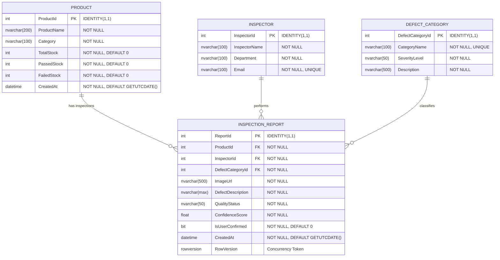

# Entity Relationship Diagram (ERD) & Database Specification

## AI Product Defect Inspection & Quality Control Assistant

---

## 1. Visual Entity Relationship Diagram



---

## 2. Detailed Entity & Column Specifications

### 2.1 Table: `Products`
Stores catalog and batch inventory counters for inspected goods.

| Column Name | SQL Type | C# Type | Nullable | Key / Constraint | Description |
| :--- | :--- | :--- | :--- | :--- | :--- |
| `ProductId` | `INT` | `int` | No | PK, Identity(1,1) | Unique identifier for product |
| `ProductName` | `NVARCHAR(200)` | `string` | No | MaxLength(200) | Commercial or internal product name |
| `Category` | `NVARCHAR(100)` | `string` | No | MaxLength(100) | Product classification/line (e.g. Điện tử, Cơ khí) |
| `TotalStock` | `INT` | `int` | No | Default: `0`, >= 0 | Registered batch / total units for inspection |
| `PassedStock` | `INT` | `int` | No | Default: `0`, >= 0 | Count of units verified as Passed |
| `FailedStock` | `INT` | `int` | No | Default: `0`, >= 0 | Count of units verified as Failed (defective) |
| `CreatedAt` | `DATETIME2` | `DateTime` | No | Default: `GETUTCDATE()` | Timestamp of product registration |

**Business Invariants:**
- `PassedStock >= 0` AND `FailedStock >= 0`
- `TotalStock >= (PassedStock + FailedStock)`

---

### 2.2 Table: `Inspectors`
Stores authorized factory quality control personnel.

| Column Name | SQL Type | C# Type | Nullable | Key / Constraint | Description |
| :--- | :--- | :--- | :--- | :--- | :--- |
| `InspectorId` | `INT` | `int` | No | PK, Identity(1,1) | Unique inspector identifier |
| `InspectorName`| `NVARCHAR(100)` | `string` | No | MaxLength(100) | Full name of QC inspector |
| `Department` | `NVARCHAR(100)` | `string` | No | MaxLength(100) | Operating department (e.g. QC Lắp ráp, QA Linh kiện) |
| `Email` | `NVARCHAR(100)` | `string` | No | MaxLength(100), UNIQUE | Official contact email address |

---

### 2.3 Table: `DefectCategories`
Defines defect typology and severity levels used by the AI engine and QC staff.

| Column Name | SQL Type | C# Type | Nullable | Key / Constraint | Description |
| :--- | :--- | :--- | :--- | :--- | :--- |
| `DefectCategoryId` | `INT` | `int` | No | PK, Identity(1,1) | Unique defect category identifier |
| `CategoryName` | `NVARCHAR(100)` | `string` | No | MaxLength(100), UNIQUE | Standardized defect name (e.g. Không có lỗi, Trầy xước) |
| `SeverityLevel` | `NVARCHAR(50)` | `string` | No | MaxLength(50) | Severity rating: `None`, `Low`, `Medium`, `High`, `Critical` |
| `Description` | `NVARCHAR(500)` | `string` | No | MaxLength(500) | Definition and visual criteria of the defect |

*Note:* A mandatory default entry with `DefectCategoryId = 1`, `CategoryName = "Không có lỗi (No Defect)"`, and `SeverityLevel = "None"` is seeded to ensure non-null foreign key integrity for flawless products.

---

### 2.4 Table: `InspectionReports`
Stores visual inspection sessions, AI diagnosis records, and human confirmation audits.

| Column Name | SQL Type | C# Type | Nullable | Key / Constraint | Description |
| :--- | :--- | :--- | :--- | :--- | :--- |
| `ReportId` | `INT` | `int` | No | PK, Identity(1,1) | Unique inspection report identifier |
| `ProductId` | `INT` | `int` | No | FK -> `Products(ProductId)` | Associated product under test |
| `InspectorId` | `INT` | `int` | No | FK -> `Inspectors(InspectorId)` | Inspector who conducted or confirmed the test |
| `DefectCategoryId` | `INT` | `int` | No | FK -> `DefectCategories(DefectCategoryId)` | Assigned defect category (or No Defect) |
| `ImageUrl` | `NVARCHAR(500)` | `string` | No | MaxLength(500) | Relative URL path to stored image in `wwwroot/uploads` |
| `DefectDescription` | `NVARCHAR(MAX)` | `string` | No | - | Detailed Vietnamese diagnosis from Gemini AI / QC notes |
| `QualityStatus` | `NVARCHAR(50)` | `string` | No | MaxLength(50) | Current quality assessment: `Passed`, `Failed`, `NeedsReview` |
| `ConfidenceScore` | `FLOAT` | `double` | No | Range: [0.0, 1.0] | AI confidence score in its visual assessment |
| `IsUserConfirmed` | `BIT` | `bool` | No | Default: `0` (false) | Flag indicating explicit human confirmation |
| `CreatedAt` | `DATETIME2` | `DateTime` | No | Default: `GETUTCDATE()` | Creation timestamp of the inspection session |
| `RowVersion` | `ROWVERSION` | `byte[]` | No | Timestamp / Concurrency | Optimistic concurrency token protecting confirmation |

---

## 3. Relationships & Foreign Key Configuration

```csharp
// EF Core Fluent API Relationship Configuration
modelBuilder.Entity<InspectionReport>(entity =>
{
    // Product 1:N InspectionReport
    entity.HasOne(r => r.Product)
          .WithMany(p => p.InspectionReports)
          .HasForeignKey(r => r.ProductId)
          .OnDelete(DeleteBehavior.Restrict);

    // Inspector 1:N InspectionReport
    entity.HasOne(r => r.Inspector)
          .WithMany(i => i.InspectionReports)
          .HasForeignKey(r => r.InspectorId)
          .OnDelete(DeleteBehavior.Restrict);

    // DefectCategory 1:N InspectionReport
    entity.HasOne(r => r.DefectCategory)
          .WithMany(c => c.InspectionReports)
          .HasForeignKey(r => r.DefectCategoryId)
          .OnDelete(DeleteBehavior.Restrict);
});
```

### Rationale for `DeleteBehavior.Restrict`:
In compliance with industrial quality control regulations (ISO 9001, Good Manufacturing Practice), inspection reports serve as official compliance audit records. Cascading deletes are strictly disallowed to prevent accidental loss of historical inspection data when a product or category is archived.

---

## 4. Performance Indexes

| Table | Index Columns | Index Type | Purpose |
| :--- | :--- | :--- | :--- |
| `Products` | `ProductName` | Non-Clustered | Fast product search & autocomplete |
| `Inspectors` | `Email` | Unique Non-Clustered | Duplicate inspector prevention |
| `DefectCategories`| `CategoryName` | Unique Non-Clustered | Fast category matching by AI name |
| `InspectionReports`| `(ProductId, CreatedAt DESC)` | Composite Non-Clustered | Filtering product inspection history chronologically |
| `InspectionReports`| `QualityStatus` | Non-Clustered | Dashboard metrics aggregation & status filtering |
| `InspectionReports`| `IsUserConfirmed` | Non-Clustered | Fast lookup of pending confirmation tasks |

---

## 5. Seed Data Specification

### 5.1 Defect Categories
1. **Id: 1** — `CategoryName`: `"Không có lỗi (No Defect)"`, `SeverityLevel`: `"None"`, `Description`: `"Sản phẩm đạt toàn bộ tiêu chuẩn chất lượng, bề mặt hoàn thiện không tì vết."`
2. **Id: 2** — `CategoryName`: `"Trầy xước bề mặt (Surface Scratch)"`, `SeverityLevel`: `"Low"`, `Description`: `"Vết trầy xước hoặc xước mờ trên bề mặt, không ảnh hưởng đến độ bền cơ học."`
3. **Id: 3** — `CategoryName`: `"Nứt gãy kết cấu (Structural Crack)"`, `SeverityLevel`: `"High"`, `Description`: `"Vết nứt vỡ hoặc rạn kết cấu làm suy giảm độ bền cơ học."`
4. **Id: 4** — `CategoryName`: `"Móp méo / Biến dạng (Dent / Deformation)"`, `SeverityLevel`: `"Medium"`, `Description`: `"Vết lõm, cong vênh vỏ hoặc thân sản phẩm do gia công hoặc va đập."`
5. **Id: 5** — `CategoryName`: `"Ăn mòn / Đổi màu (Discoloration / Corrosion)"`, `SeverityLevel`: `"Medium"`, `Description`: `"Ố màu bề mặt, oxy hóa, gỉ sét hoặc đổi màu lớp phủ bảo vệ."`
6. **Id: 6** — `CategoryName`: `"Lệch khớp lắp ráp (Assembly Misalignment)"`, `SeverityLevel`: `"High"`, `Description`: `"Hở mối nối, khe hở sai lệch hoặc thiếu chốt vít linh kiện lắp ráp."`

### 5.2 Inspectors
1. **Id: 1** — `InspectorName`: `"Nguyễn Văn An"`, `Department`: `"QC Điện Tử & Màn Hình"`, `Email`: `"an.nguyen@factoryqc.vn"`
2. **Id: 2** — `InspectorName`: `"Trần Thị Bích"`, `Department`: `"QC Gia Công Cơ Khí"`, `Email`: `"bich.tran@factoryqc.vn"`
3. **Id: 3** — `InspectorName`: `"Lê Hoàng Nam"`, `Department`: `"QA Đóng Gói & Xuất Xưởng"`, `Email`: `"nam.le@factoryqc.vn"`

### 5.3 Products
1. **Id: 1** — `ProductName`: `"Màn hình OLED 6.7 inch FHD+"`, `Category`: `"Linh kiện điện tử"`, `TotalStock`: 500, `PassedStock`: 450, `FailedStock`: 12, `CreatedAt`: 30 days ago
2. **Id: 2** — `ProductName`: `"Vỏ nhôm Anode động cơ servo"`, `Category`: `"Cơ khí chính xác"`, `TotalStock`: 250, `PassedStock`: 210, `FailedStock`: 18, `CreatedAt`: 20 days ago
3. **Id: 3** — `ProductName`: `"Bo mạch chủ IoT Gateway v2.1"`, `Category`: `"Linh kiện điện tử"`, `TotalStock`: 180, `PassedStock`: 165, `FailedStock`: 5, `CreatedAt`: 15 days ago
4. **Id: 4** — `ProductName`: `"Bộ gốm cách điện chịu áp cao"`, `Category`: `"Vật liệu cách điện"`, `TotalStock`: 300, `PassedStock`: 280, `FailedStock`: 8, `CreatedAt`: 10 days ago
5. **Id: 5** — `ProductName`: `"Cụm camera cảm biến hồng ngoại"`, `Category`: `"Quang học chính xác"`, `TotalStock`: 120, `PassedStock`: 98, `FailedStock`: 6, `CreatedAt`: 5 days ago
