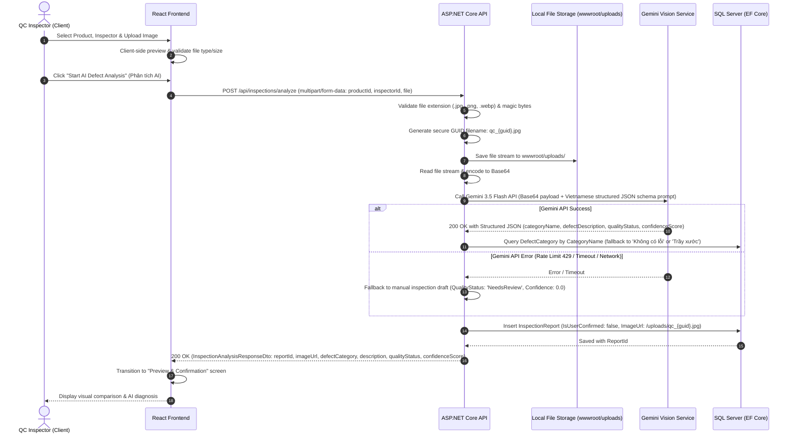
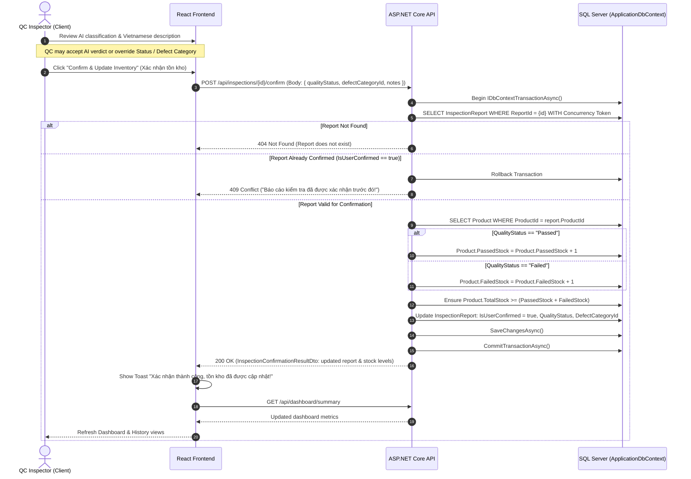
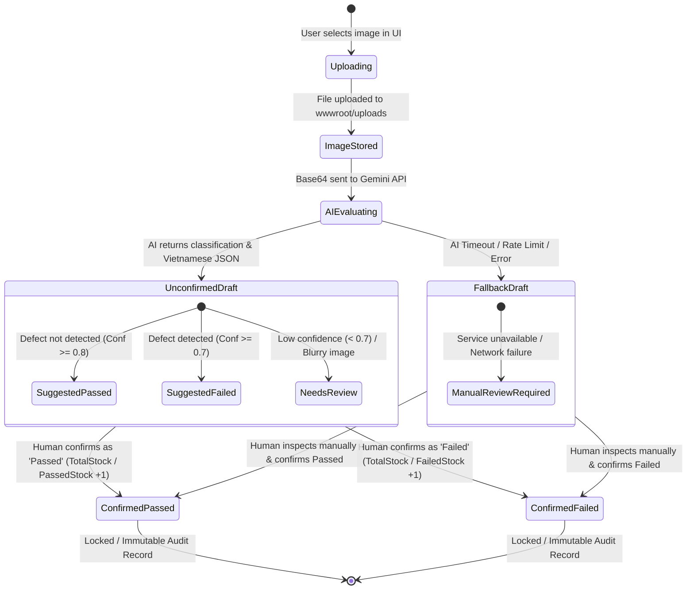

# System Workflow & Architecture Documentation

## AI Product Defect Inspection & Quality Control Assistant

---

## 1. High-Level System Architecture

Based on the official homework specification (Page 3), the system is divided into five core operational tiers:

```mermaid
flowchart LR
    subgraph S1["1. User Interface (React)"]
        UI1["Upload product image"]
        UI2["Select Product & Inspector"]
        UI3["View Live Preview & Result"]
        UI4["Dashboard QC Metrics"]
    end

    subgraph S2["2. Web API Backend (ASP.NET Core)"]
        API1["Receive multipart/form-data"]
        API2["Validate Magic Bytes & Size"]
        API3["Save to wwwroot/uploads"]
        API4["Base64 Image Encoding"]
    end

    subgraph S3["3. AI Vision Service (Gemini API)"]
        AI1["Multimodal Vision Analysis"]
        AI2["Enforce Structured JSON Output"]
        AI3["Vietnamese Defect Description"]
        AI4["Retry & Rate Limit Handling"]
    end

    subgraph S4["4. Review & Confirmation"]
        QC1["Display AI Extracted JSON"]
        QC2["QC Human Verification"]
        QC3["Override / Confirm 'Pass' or 'Fail'"]
        QC4["Explicit Submit"]
    end

    subgraph S5["5. Database Transaction (EF Core / SQL Server)"]
        DB1["Create IDbContextTransaction"]
        DB2["Verify Duplicate Confirmation"]
        DB3["Update Passed/Failed Stock"]
        DB4["Commit Transaction"]
    end

    S1 -->|POST /api/inspections/analyze| S2
    S2 -->|Base64 & Vietnamese Prompt| S3
    S3 -->|Structured JSON Result| S2
    S2 -->|Analysis DTO & ReportId| S1
    S1 -->|Display Analysis for Review| S4
    S4 -->|POST /api/inspections/{id}/confirm| S5
    S5 -->|Update Dashboard & Real-time Stats| S1
```

---

## 2. End-to-End Sequence Diagrams

### 2.1 Workflow 1: Image Upload & AI Analysis (`POST /api/inspections/analyze`)

> [!IMPORTANT]
> **Zero Inventory Mutation Rule:** During the analysis phase, the database strictly logs the inspection report in an unconfirmed state (`IsUserConfirmed = false`). **No product inventory counters are modified during this step.**



---

### 2.2 Workflow 2: Human QC Review & Confirmation (`POST /api/inspections/{id}/confirm`)

> [!IMPORTANT]
> **Atomic Inventory Update Rule:** The database update uses an explicit `IDbContextTransaction`. If stock updates or report updates fail, the entire transaction is rolled back.



---

## 3. Inspection Report Lifecycle & State Machine



---

## 4. Edge Cases & Resilience Strategy

| Scenario | Risk | Mitigation Architecture |
| :--- | :--- | :--- |
| **Blurry / Unclear Image** | AI misclassifies defect or outputs false positive | System prompt directs Gemini to detect image clarity. If blurry or unreadable, Gemini outputs `QualityStatus: "NeedsReview"` and `ConfidenceScore < 0.5`. UI flags the item with an amber warning badge, disabling automatic approval. |
| **Gemini Rate Limit (HTTP 429) / Offline** | Inspection process fails abruptly | Backend catches the error and creates an unconfirmed draft report in `NeedsReview` state with an explanatory message (`isAiFallback: true`), returning HTTP 200 OK to allow manual inspection and avoid a 500/503 crash. |
| **Duplicate Confirmation** | User double-clicks "Confirm", inflating inventory twice | Front-end disables the button immediately upon click. Backend checks `IsUserConfirmed` inside the `IDbContextTransaction`. If `true`, throws HTTP 409 Conflict. EF Core `RowVersion` handles concurrent race conditions. |
| **Database Failure during Update** | Stock updated but report not confirmed (data desync) | All updates are wrapped inside `using var transaction = await _context.Database.BeginTransactionAsync()`. Any failure executes `transaction.RollbackAsync()`. |
| **Unsafe File Upload** | Malicious script uploaded (`.php`, `.exe`, path traversal) | File extension whitelist (`.jpg, .jpeg, .png, .webp`). Magic byte header verification. File renamed to random GUID. Stored outside source directories in `wwwroot/uploads`. |
| **Non-null DefectCategoryId on Passed Items** | Foreign key violation when no defect exists | Database seeds `DefectCategoryId = 1` with name `"Không có lỗi (No Defect)"` and severity `"None"`. All Passed inspections are mapped to Category ID 1. |
